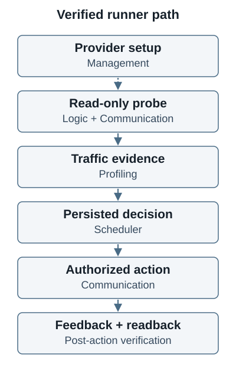

<picture>
  <source media="(prefers-color-scheme: dark)" srcset="./assets/hero-dark.svg">
  <source media="(prefers-color-scheme: light)" srcset="./assets/hero-light.svg">
  
</picture>

I study how smart home automation can make communication, rule reasoning, traffic observation, concurrent scheduling, and service management work together at the edge.

## Smart Home Edge Computing System

[System hub](https://github.com/David-Lee-11101/SmartHome-Edge-Computing-System) · [System documentation](https://github.com/David-Lee-11101/SmartHome-Edge-Computing-System/tree/main/docs)

The portfolio is organized as one research system with five components. Repository demonstrations and tests establish bounded software behavior; they do not establish deployment readiness or reproduce unavailable historical experiments.

| Component | Role in the system |
| --- | --- |
| [Communication](https://github.com/David-Lee-11101/Smart-Home-Communication) | RPC transport, service discovery, request correlation, and observable service calls |
| [Logic Engine](https://github.com/David-Lee-11101/SmartHome-Logic-Engine) | Rule analysis, conflict and dependency reasoning, and action invocation |
| [Traffic Profiling](https://github.com/David-Lee-11101/SmartHome-Traffic-Profiling) | Traffic-derived features and trace evidence for automation research |
| [ThreadSafe Scheduler](https://github.com/David-Lee-11101/SmartHome-ThreadSafe-Scheduler) | Concurrent rule scheduling and explicit execution decisions |
| [Integrated Logic Management](https://github.com/David-Lee-11101/SmartHome-Integrated-Logic-Management) | Rule composition, service generation, lifecycle management, and operator tooling |

The service generator belongs to Integrated Logic Management; its historical repository remains available for provenance. The hub is the place to check integration instructions, revision pins, evidence, and current limitations. Measurements require an identified environment and reproducible inputs; no portfolio-wide speed or accuracy claims are made here.

## Agent governance research

[Imperium](https://github.com/David-Lee-11101/Imperium) contains a Java and React workflow MVP. **Senate-Agent-Orchestration** is the proposed descriptive identity for its future Roman Senate inspired multiagent framework. Deliberation, veto review, execution authority, recovery, and audit are the research questions; the current code is an incomplete foundation. See its [proposal and boundaries](https://github.com/David-Lee-11101/Imperium/blob/continuation/portfolio-20261012/docs/SENATE_PROPOSAL.md) on the documentation candidate branch.

## How I work

- Make failure behavior and lifecycle ownership explicit.
- Preserve experimental provenance and distinguish new tests from historical results.
- Keep architecture inspectable through small demonstrations and reviewable evidence.
- Treat privacy and rights as part of research publication.

Public visibility does not grant a general reuse license. Repository-specific notices and third-party licenses govern their respective content.

I also maintain a [personal oh-my-codex fork](https://github.com/David-Lee-11101/oh-my-codex) for study. Upstream authorship belongs to [oh-my-codex](https://github.com/Yeachan-Heo/oh-my-codex).
